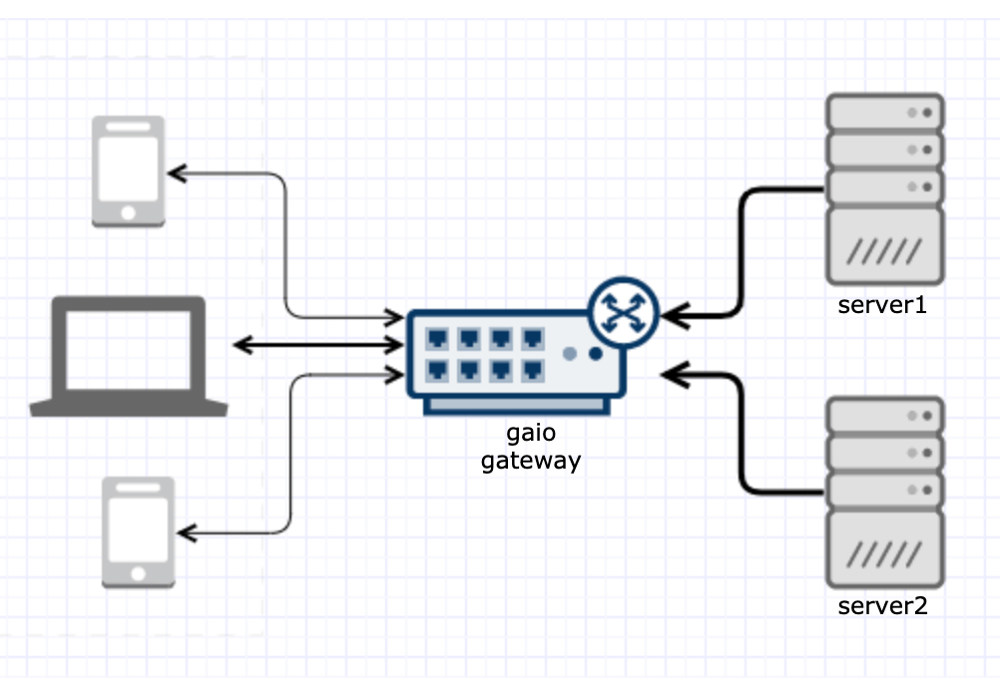
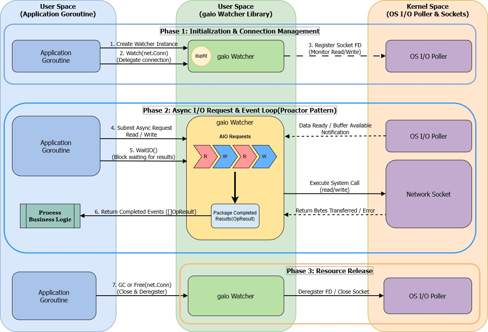
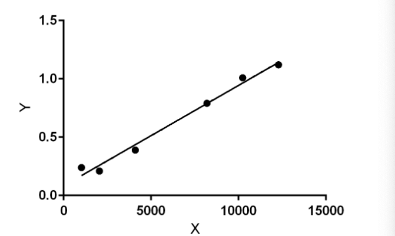

# gaio

[![GoDoc][1]][2] [![MIT licensed][3]][4] [![Build Status][5]][6] [![Coverage Statusd][9]][10]

[1]: https://godoc.org/github.com/xtaci/gaio?status.svg
[2]: https://pkg.go.dev/github.com/xtaci/gaio
[3]: https://img.shields.io/badge/license-MIT-blue.svg
[4]: LICENSE
[5]: https://img.shields.io/github/created-at/xtaci/gaio
[6]: https://img.shields.io/github/created-at/xtaci/gaio
[9]: https://codecov.io/gh/xtaci/gaio/branch/master/graph/badge.svg
[10]: https://codecov.io/gh/xtaci/gaio

 

## Introduction
[中文文档](README_zh.md) | [中文介绍(知乎)](https://zhuanlan.zhihu.com/p/102890337)

In a typical Go network server, each accepted connection is handled by a goroutine that calls `Read` and `Write`. This is simple and effective for many workloads, but a large number of mostly idle connections can make per-connection goroutines and buffers a significant part of the resource cost.

gaio provides an asynchronous I/O API: submit read and write requests to a `Watcher`, then collect their completions with `WaitIO`. This lets an application manage many connections without dedicating a goroutine to each one. Reads can use caller-provided buffers or a shared internal buffer when passed `nil`.

## How It Works



The connection must expose its socket through `SyscallConn` (as standard TCP connections do). On Unix, gaio uses `dup` to create a second file descriptor for the same socket; on Windows, it uses `WSADuplicateSocket`. This lets the watcher register and manage its own handle while preserving the socket's state and options. After registering the duplicate, gaio closes the original `net.Conn`, so the connection must not be used directly afterward. The platform poller reports readiness, gaio performs the requested I/O, and `WaitIO` returns the completions.

## Features

- **Asynchronous API:** Submit reads and writes and receive their completions in batches through `WaitIO`.
- **Flexible buffering:** Pass `nil` to `Read` to use the watcher's shared internal read buffer. `NewWatcher` uses a 64 KiB internal buffer; `NewWatcherSize` lets you choose its size.
- **Connection control:** Choose when to hand a connection to the watcher, for example after completing a protocol handshake.
- **Back-pressure:** Control when read and write requests are submitted. Delaying reads can let TCP's receive-window flow control reduce the sender's rate.
- **Platform pollers:** Uses epoll on Linux, kqueue on macOS and BSD variants, and WSAPoll on Windows.

## Conventions

- **Connection ownership:** The first I/O request transfers the connection to the watcher. The watcher duplicates the socket and closes the original `net.Conn`; do not call methods on that `net.Conn` afterward. The socket options already set on the connection remain in effect.
  
- **Resource management:** Call `Watcher.Free(conn)` when a connection is no longer needed; this queues it for release by the watcher. Explicitly call `Watcher.Close()` when shutting down. Finalizers provide fallback cleanup, but should not replace explicit resource management.

- **Load Balancing:** For connection load balancing, create multiple `gaio.Watcher` instances and distribute `net.Conn` using your preferred strategy. For acceptor load balancing, use `go-reuseport` as the listener.

- **Result and buffer lifetime:** The result slice returned by `WaitIO` is reused by the next call. For reads submitted with a nil buffer, the returned buffer remains valid until the next `WaitIO` call.

## TL;DR

```go
package main

import (
        "log"
        "net"

        "github.com/xtaci/gaio"
)

// this goroutine waits for all I/O events and sends back everything it receives
// in an async manner
func echoServer(w *gaio.Watcher) {
        for {
                // loop wait for any IO events
                results, err := w.WaitIO()
                if err != nil {
                        log.Println(err)
                        return
                }

                for _, res := range results {
                        switch res.Operation {
                        case gaio.OpRead: // read completion event
                                if res.Error == nil {
                                        // send back everything, we won't start to read again until write completes.
                                        // submit an async write request
                                        w.Write(nil, res.Conn, res.Buffer[:res.Size])
                                }
                        case gaio.OpWrite: // write completion event
                                if res.Error == nil {
                                        // since write has completed, let's start read on this conn again
                                        w.Read(nil, res.Conn, res.Buffer[:cap(res.Buffer)])
                                }
                        }
                }
        }
}

func main() {
        w, err := gaio.NewWatcher()
        if err != nil {
              log.Fatal(err)
        }
        defer w.Close()
	
        go echoServer(w)

        ln, err := net.Listen("tcp", "localhost:0")
        if err != nil {
                log.Fatal(err)
        }
        log.Println("echo server listening on", ln.Addr())

        for {
                conn, err := ln.Accept()
                if err != nil {
                        log.Println(err)
                        return
                }
                log.Println("new client", conn.RemoteAddr())

                // submit the first async read IO request
                err = w.Read(nil, conn, make([]byte, 128))
                if err != nil {
                        log.Println(err)
                        return
                }
        }
}

```

### More examples

<details>
	<summary> Push server </summary>
        package main

```go
package main

import (
        "fmt"
        "log"
        "net"
        "time"

        "github.com/xtaci/gaio"
)

func main() {
        // by simply replace net.Listen with reuseport.Listen, everything is the same as in push-server
        // ln, err := reuseport.Listen("tcp", "localhost:0")
        ln, err := net.Listen("tcp", "localhost:0")
        if err != nil {
                log.Fatal(err)
        }

        log.Println("pushing server listening on", ln.Addr(), ", use telnet to receive push")

        // create a watcher
        w, err := gaio.NewWatcher()
        if err != nil {
                log.Fatal(err)
        }

        // channel
        ticker := time.NewTicker(time.Second)
        chConn := make(chan net.Conn)
        chIO := make(chan gaio.OpResult)

        // watcher.WaitIO goroutine
        go func() {
                for {
                        results, err := w.WaitIO()
                        if err != nil {
                                log.Println(err)
                                return
                        }

                        for _, res := range results {
                                chIO <- res
                        }
                }
        }()

        // main logic loop, like your program core loop.
        go func() {
                var conns []net.Conn
                for {
                        select {
                        case res := <-chIO: // receive IO events from watcher
                                if res.Error != nil {
                                        continue
                                }
                                conns = append(conns, res.Conn)
                        case t := <-ticker.C: // receive ticker events
                                push := []byte(fmt.Sprintf("%s\n", t))
                                // all conn will receive the same 'push' content
                                for _, conn := range conns {
                                        w.Write(nil, conn, push)
                                }
                                conns = nil
                        case conn := <-chConn: // receive new connection events
                                conns = append(conns, conn)
                        }
                }
        }()

        // this loop keeps on accepting connections and send to main loop
        for {
                conn, err := ln.Accept()
                if err != nil {
                        log.Println(err)
                        return
                }
                chConn <- conn
        }
}

```
</details>

## Documentation

For the API reference, see [pkg.go.dev](https://pkg.go.dev/github.com/xtaci/gaio).

## Benchmarks

| Test Case | Throughput test with 64KB buffer |
|:-------------:|-----------------------------------------------------------------------------------------------------------------------------------------------------------------------------------------------------------------|
| Description | A client continuously sends 64KB of data to the server. The server reads the data and echoes it back. The client continues receiving until all bytes are successfully received. |
| Command | `go test -run='^$' -bench '^BenchmarkEcho64K$' -benchmem` |
| MacBook Pro | 1695.27 MB/s 518 B/op 4 allocs/op|
| Linux AMD64 | 1883.23 MB/s 518 B/op 4 allocs/op|
| Raspberry Pi4 | 354.59 MB/s 334 B/op 4 allocs/op|

| Test Case | 8K concurrent connection echo test |
|:-------------:|-----------------------------------------------------------------------------------------------------------------------------------------------------------------------------------------------------------------|
|Description| Starts 8192 clients, each sending 1KB of data to the server. The server reads and echoes back the data, and each client continues receiving until all bytes are successfully received.|
| Command | `go test -v -run=8k` |
| MacBook Pro | 1.09s |
| Linux AMD64 | 0.94s |
| Raspberry Pi4 | 2.09s |

These are historical, environment-specific results; the original Go versions and test conditions were not recorded. They are not performance guarantees.

## Testing Directives
Run `go test -short ./...` to skip the 8k, 10k, and 12k concurrent-connection tests, including both 10k swap-buffer tests.

On macOS, you need to increase the maximum open files limit to run the benchmarks.

```bash
sysctl -w kern.ipc.somaxconn=4096
sysctl -w kern.maxfiles=100000
sysctl -w kern.maxfilesperproc=100000
sysctl -w net.inet.ip.portrange.first=1024
sysctl -w net.inet.ip.portrange.last=65535

ulimit -S -n 65536
```

### Regression



X -> number of concurrent connections, Y -> time of completion in seconds

```
Best-fit values	 
Slope	8.613e-005 ± 5.272e-006
Y-intercept	0.08278 ± 0.03998
X-intercept	-961.1
1/Slope	11610
 
95% Confidence Intervals	 
Slope	7.150e-005 to 0.0001008
Y-intercept	-0.02820 to 0.1938
X-intercept	-2642 to 287.1
 
Goodness of Fit	 
R square	0.9852
Sy.x	0.05421
 
Is slope significantly non-zero?	 
F	266.9
DFn,DFd	1,4
P Value	< 0.0001
Deviation from horizontal?	Significant
 
Data	 
Number of XY pairs	6
Equation	Y = 8.613e-005*X + 0.08278
```

## FAQ
1. If you encounter an error like:

```
# github.com/xtaci/gaio [github.com/xtaci/gaio.test]
./aio_linux.go:155:7: undefined: setAffinity
./watcher.go:588:4: undefined: setAffinity
FAIL	github.com/xtaci/gaio [build failed]
FAIL
```

ensure that gcc/clang is installed.

## License

The `gaio` source code is available under the MIT [License](/LICENSE).

## References

* https://zhuanlan.zhihu.com/p/102890337 -- gaio小记
* https://github.com/xtaci/grasshopper -- A secure chained relayer for UDP made of gaio
* https://github.com/golang/go/issues/15735 -- net: add mechanism to wait for readability on a TCPConn
* https://en.wikipedia.org/wiki/C10k_problem -- C10K
* https://golang.org/src/runtime/netpoll_epoll.go -- epoll in golang 
* https://www.freebsd.org/cgi/man.cgi?query=kqueue&sektion=2 -- kqueue
* https://idea.popcount.org/2017-02-20-epoll-is-fundamentally-broken-12/ -- epoll is fundamentally broken
* https://en.wikipedia.org/wiki/Transmission_Control_Protocol#Flow_control -- TCP Flow Control 
* http://www.idc-online.com/technical_references/pdfs/data_communications/Congestion_Control.pdf -- Back-pressure
