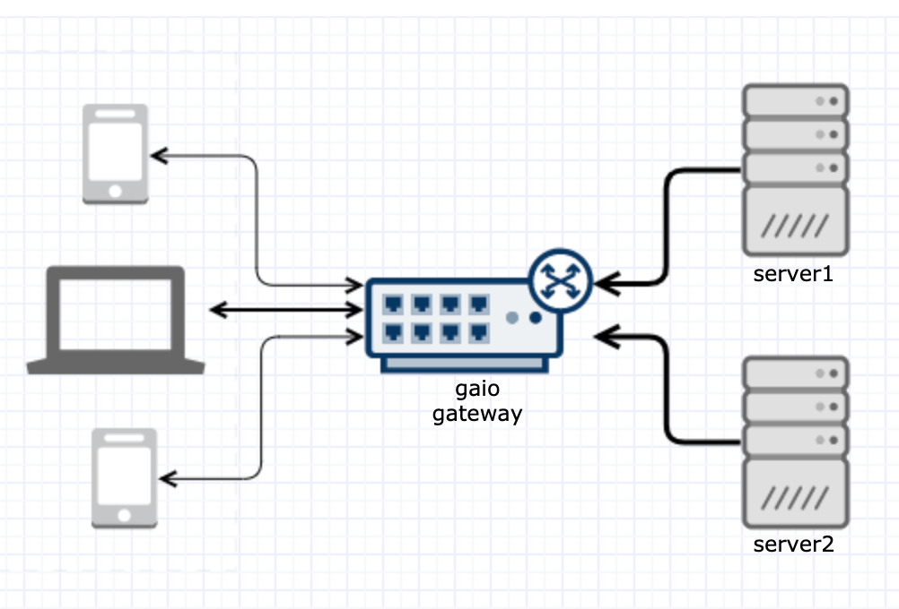
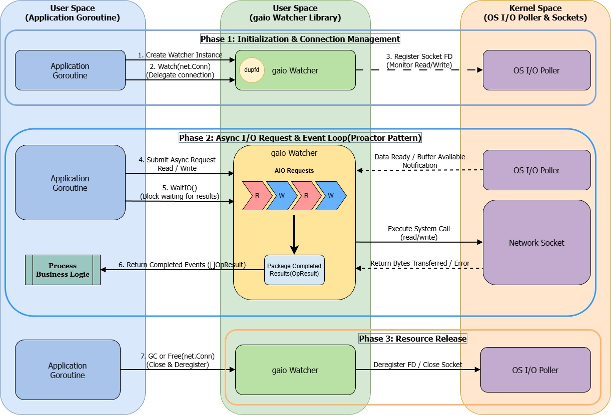
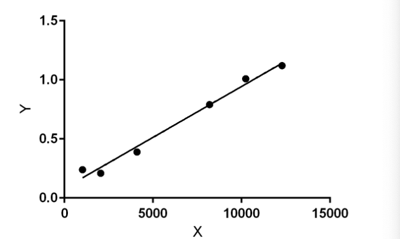

# gaio

[![GoDoc][1]][2] [![MIT licensed][3]][4] [![Build Status][5]][6] [![Coverage Statusd][9]][10]

[1]: https://godoc.org/github.com/xtaci/gaio\?status.svg
[2]: https://pkg.go.dev/github.com/xtaci/gaio
[3]: https://img.shields.io/badge/license-MIT-blue.svg
[4]: LICENSE
[5]: https://img.shields.io/github/created-at/xtaci/gaio
[6]: https://img.shields.io/github/created-at/xtaci/gaio
[9]: https://codecov.io/gh/xtaci/gaio/branch/master/graph/badge.svg
[10]: https://codecov.io/gh/xtaci/gaio



## 简介
[English](README.md)

典型的 Go 网络服务会为每个连接分配一个 goroutine，并通过 `Read`、`Write` 处理数据。这种方式简单有效；但在大量连接大部分时间处于空闲状态时，每连接的 goroutine 和缓冲区也会占用可观资源。

gaio 提供异步 I/O API：向 `Watcher` 提交读写请求，再通过 `WaitIO` 获取完成结果。应用无需为每个连接单独分配 goroutine，即可管理大量连接。读取时可以传入调用方的缓冲区，也可以传入 `nil` 使用 watcher 的共享内部缓冲区。

## 工作原理



连接需要通过 `SyscallConn` 暴露底层 socket（标准 TCP 连接支持该接口）。在 Unix 上，gaio 使用 `dup` 创建一个指向同一 socket 的新文件描述符；在 Windows 上，则使用 `WSADuplicateSocket`。这样 watcher 可以注册并独立管理自己的句柄，同时保留 socket 状态和选项。副本注册成功后，gaio 会关闭原始 `net.Conn`，因此之后不能再直接使用该连接。平台 poller 检测到就绪事件后，gaio 执行相应 I/O，并由 `WaitIO` 返回完成结果。

## 特性

- **异步 API：** 提交读写请求，并通过 `WaitIO` 批量获取完成结果。
- **灵活缓冲：** `Read` 的缓冲区参数传入 `nil` 时使用 watcher 的共享内部读缓冲区。`NewWatcher` 默认使用 64 KiB 缓冲区；也可以通过 `NewWatcherSize` 指定大小。
- **连接托管时机可控：** 可以自行选择何时将连接交给 watcher，例如在协议握手完成后。
- **背压控制：** 应用可以控制读写请求的提交时机；延迟读取可让 TCP 接收窗口流控降低发送端的发送速率。
- **平台 poller：** Linux 使用 epoll，macOS 和 BSD 系统使用 kqueue，Windows 使用 WSAPoll。

## 约定

- **连接所有权：** 首个 I/O 请求会将连接交给 watcher。watcher 会复制 socket 并关闭原始 `net.Conn`；之后不要再调用该 `net.Conn` 的方法。此前设置的 socket 选项会继续生效。
- **资源释放：** 连接不再需要时调用 `Watcher.Free(conn)`，请求会排队交由 watcher 释放。程序退出或不再使用 watcher 时，应显式调用 `Watcher.Close()`。终结器仅作为兜底，不应替代显式释放。
- **负载均衡：** 可以创建多个 watcher 并使用任意策略分发连接；在监听层面建议配合 `go-reuseport` 做 acceptor 负载均衡。
- **结果与缓冲区有效期：** `WaitIO` 返回的结果切片会在下一次调用时复用。读请求使用 `nil` 缓冲区时，返回的缓冲区在下一次调用 `WaitIO` 前有效。

## 快速开始 (TL;DR)

```go
package main

import (
        "log"
        "net"

        "github.com/xtaci/gaio"
)

// echoServer 消费所有 I/O 事件，并把读到的数据异步写回
func echoServer(w *gaio.Watcher) {
        for {
                results, err := w.WaitIO()
                if err != nil {
                        log.Println(err)
                        return
                }

                for _, res := range results {
                        switch res.Operation {
                        case gaio.OpRead:
                                if res.Error == nil {
                                        w.Write(nil, res.Conn, res.Buffer[:res.Size])
                                }
                        case gaio.OpWrite:
                                if res.Error == nil {
                                        w.Read(nil, res.Conn, res.Buffer[:cap(res.Buffer)])
                                }
                        }
                }
        }
}

func main() {
        w, err := gaio.NewWatcher()
        if err != nil {
              log.Fatal(err)
        }
        defer w.Close()

        go echoServer(w)

        ln, err := net.Listen("tcp", "localhost:0")
        if err != nil {
                log.Fatal(err)
        }
        log.Println("echo server listening on", ln.Addr())

        for {
                conn, err := ln.Accept()
                if err != nil {
                        log.Println(err)
                        return
                }
                log.Println("new client", conn.RemoteAddr())

                if err := w.Read(nil, conn, make([]byte, 128)); err != nil {
                        log.Println(err)
                        return
                }
        }
}
```

### 更多示例

<details>
	<summary>推送服务器 (Push server)</summary>

```go
package main

import (
        "fmt"
        "log"
        "net"
        "time"

        "github.com/xtaci/gaio"
)

func main() {
        // 替换为 reuseport.Listen 即可实现多实例监听
        // ln, err := reuseport.Listen("tcp", "localhost:0")
        ln, err := net.Listen("tcp", "localhost:0")
        if err != nil {
                log.Fatal(err)
        }

        log.Println("pushing server listening on", ln.Addr(), ", use telnet to receive push")

        w, err := gaio.NewWatcher()
        if err != nil {
                log.Fatal(err)
        }

        ticker := time.NewTicker(time.Second)
        chConn := make(chan net.Conn)
        chIO := make(chan gaio.OpResult)

        go func() {
                for {
                        results, err := w.WaitIO()
                        if err != nil {
                                log.Println(err)
                                return
                        }

                        for _, res := range results {
                                chIO <- res
                        }
                }
        }()

        go func() {
                var conns []net.Conn
                for {
                        select {
                        case res := <-chIO:
                                if res.Error != nil {
                                        continue
                                }
                                conns = append(conns, res.Conn)
                        case t := <-ticker.C:
                                push := []byte(fmt.Sprintf("%s\n", t))
                                for _, conn := range conns {
                                        w.Write(nil, conn, push)
                                }
                                conns = nil
                        case conn := <-chConn:
                                conns = append(conns, conn)
                        }
                }
        }()

        for {
                conn, err := ln.Accept()
                if err != nil {
                        log.Println(err)
                        return
                }
                chConn <- conn
        }
}
```
</details>

## 文档

API 参考文档请查阅 [pkg.go.dev](https://pkg.go.dev/github.com/xtaci/gaio)。

## 基准测试

| 测试用例 | 64KB 缓冲区吞吐量测试 |
|:-------------:|-----------------------------------------------------------------------------------------------------------------------------------------------------------------------------------------------------------------|
| 描述 | 客户端持续向服务器发送 64KB 数据，服务器读取后立即回显，客户端持续接收直到全部字节完成。|
| 命令 | `go test -run='^$' -bench '^BenchmarkEcho64K$' -benchmem` |
| MacBook Pro | 1695.27 MB/s 518 B/op 4 allocs/op |
| Linux AMD64 | 1883.23 MB/s 518 B/op 4 allocs/op |
| Raspberry Pi4 | 354.59 MB/s 334 B/op 4 allocs/op |

| 测试用例 | 8K 并发连接回显测试 |
|:-------------:|-----------------------------------------------------------------------------------------------------------------------------------------------------------------------------------------------------------------|
| 描述 | 启动 8192 个客户端，每个发送 1KB 数据；服务器回显，直至所有客户端完全收齐。|
| 命令 | `go test -v -run=8k` |
| MacBook Pro | 1.09s |
| Linux AMD64 | 0.94s |
| Raspberry Pi4 | 2.09s |

以上为历史测试结果，原始 Go 版本和测试条件未记录；结果受硬件和运行环境影响，不代表性能保证。

## 测试指令

运行 `go test -short ./...` 可跳过 8k、10k 和 12k 并发连接测试，包括两个 10k 交换缓冲区测试。

在 macOS 上运行基准前，请先提升最大文件描述符限制：

```bash
sysctl -w kern.ipc.somaxconn=4096
sysctl -w kern.maxfiles=100000
sysctl -w kern.maxfilesperproc=100000
sysctl -w net.inet.ip.portrange.first=1024
sysctl -w net.inet.ip.portrange.last=65535

ulimit -S -n 65536
```

### 回归测试



X -> 并发连接数，Y -> 完成时间（秒）

```
Best-fit values 
Slope8.613e-005 ± 5.272e-006
Y-intercept0.08278 ± 0.03998
X-intercept-961.1
1/Slope11610
 
95% Confidence Intervals 
Slope7.150e-005 to 0.0001008
Y-intercept-0.02820 to 0.1938
X-intercept-2642 to 287.1
 
Goodness of Fit 
R square0.9852
Sy.x0.05421
 
Is slope significantly non-zero? 
F266.9
DFn,DFd1,4
P Value< 0.0001
Deviation from horizontal?Significant
 
Data 
Number of XY pairs6
EquationY = 8.613e-005*X + 0.08278
```

## 常见问题 (FAQ)

1. 编译时报错：

```
# github.com/xtaci/gaio [github.com/xtaci/gaio.test]
./aio_linux.go:155:7: undefined: setAffinity
./watcher.go:588:4: undefined: setAffinity
FAIL    github.com/xtaci/gaio [build failed]
FAIL
```

   请确认系统已安装 gcc 或 clang。

## 许可证

`gaio` 以 MIT [许可证](/LICENSE) 发布。

## 参考资料

* https://zhuanlan.zhihu.com/p/102890337 -- gaio 小记
* https://github.com/xtaci/grasshopper -- 基于 gaio 的安全链式中继器
* https://github.com/golang/go/issues/15735 -- net: add mechanism to wait for readability on a TCPConn
* https://en.wikipedia.org/wiki/C10k_problem -- C10K
* https://golang.org/src/runtime/netpoll_epoll.go -- epoll in golang
* https://www.freebsd.org/cgi/man.cgi\?query\=kqueue\&sektion\=2 -- kqueue
* https://idea.popcount.org/2017-02-20-epoll-is-fundamentally-broken-12/ -- epoll is fundamentally broken
* https://en.wikipedia.org/wiki/Transmission_Control_Protocol\#Flow_control -- TCP Flow Control 
* http://www.idc-online.com/technical_references/pdfs/data_communications/Congestion_Control.pdf -- Back-pressure
